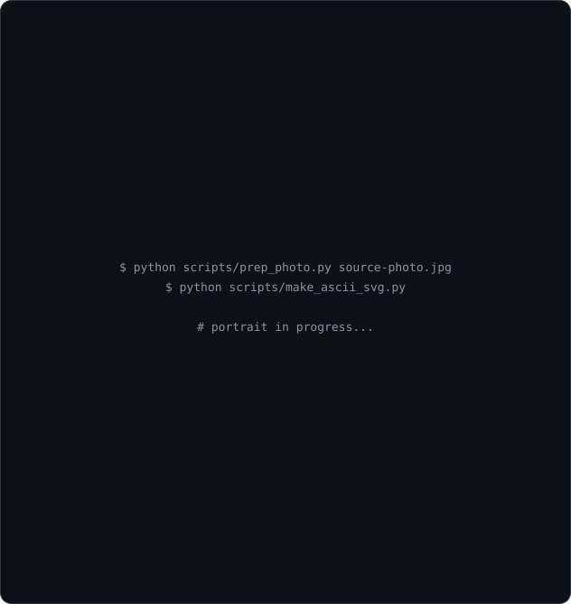

# PAPA YOUSSOU NDIAYE

<div align="center">


### `BACKEND DEVELOPER` · `AI ENTHUSIAST` · `DEVOPS` · `CYBERSECURITY`

<br>

<h3><code>ndiaye45@github ~ $ ./contributions.sh</code></h3>


<br><br>

<h3><code>ndiaye45@github ~ $ whoami</code></h3>
<table>
  <tr>
    <td valign="top"></td>
    <td valign="top"></td>
  </tr>
</table>

</div>

## `./tech-stack.sh`

### `BACKEND`


### `DEVOPS & TOOLS`


### `AI & DATA`


### `FRONTEND & MOBILE`


### `TESTING`


## `./projects.sh`

### `01` — [Savings](https://github.com/ndiaye45/Savings)

**Personal Savings Management · Spring Boot**

- REST API for personal savings management.
- Authentication and JWT security.
- PostgreSQL integration.
- Docker containerization.
- GitHub Actions CI.

### `02` — [Service Management](https://github.com/ndiaye45/Service-management)

**Service Marketplace · Spring Boot & Angular**

- REST API for clients and service providers.
- Service requests and user management.
- JWT authentication and authorization.
- Angular frontend and PostgreSQL.

### `03` — [ImageLib](https://github.com/ndiaye45/imagelib-javafx)

**Image Management Application · JavaFX**

- Image processing and transformation pipeline.
- JSON and text-based metadata management.
- ML-based image tag suggestions.
- K-means dominant color extraction.
- Automated tests with JUnit 5.

### `04` — AP Santé

**Physical Fitness Assessment · Flutter & Firebase**

- Mobile application developed for the University of Limoges with SUAPS and Student Health Services.
- Firebase Authentication and Cloud Firestore.
- BMI calculation and physical activity questionnaire.
- 9 fitness tests across 4 categories.
- Radar chart visualization and personalized recommendations.
- PDF report generation.

### `05` — [Couture For Fun](https://github.com/ndiaye45/coutureforfunL2project)

**Sewing Workshop Website · PHP & MySQL**

- Dynamic workshop and course catalog.
- User registration and account management.
- MySQL database integration.
- Interactive frontend using HTML, CSS and JavaScript.

## `./education.sh`

**Master's Degree in Computer Science — ARIAS**

Université d'Orléans, France

*Applications réparties, Intelligence artificielle et sécurité*

**Bachelor's Degree in Computer Science**

Université de Limoges, France

## `./opportunities.sh`

```bash
STATUS: OPEN_TO_INTERNSHIP
POSITION: Backend Developer / Software Engineer
DURATION: 4–6 MONTHS
START: JANUARY 2027

FOCUS:
  - Java / Spring Boot
  - Software Engineering
  - Distributed Systems
  - Backend Architecture
  - Security
```

Currently looking for an internship where I can contribute to real-world software projects while strengthening my skills in backend architecture, distributed systems and software security.

## `./contact.sh`

<div align="center">

[](https://yousndiaye.netlify.app)

[](https://github.com/ndiaye45)

</div>

<div align="center">

```text
╔══════════════════════════════════════════════════════╗
║                SYSTEM STATUS: ONLINE                 ║
║           BUILDING • LEARNING • INNOVATING           ║
╚══════════════════════════════════════════════════════╝
```

**`while(alive) { code(); learn(); innovate(); }`**

</div>
