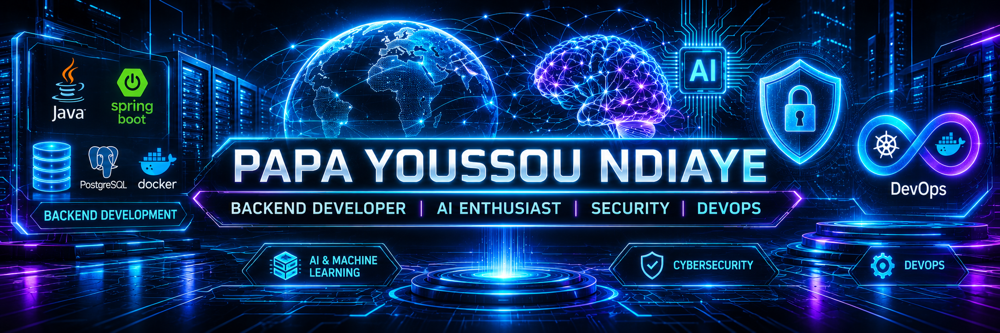

# 👋 Hi, I'm Papa Youssou Ndiaye

### Backend Developer | Java & Spring Boot

  

🎓 Master's student in Computer Science — ARIAS, University of Orléans  
💻 Interested in Backend Development, Distributed Systems, AI and Cybersecurity  
🚀 Building applications with Java, Spring Boot and PostgreSQL

---

### 🛠️ Technologies

- **Languages:** Java, Python, SQL
- **Backend:** Spring Boot, REST APIs, Spring Security
- **Frontend:** Angular, JavaFX, Flutter, PHP, HTML, CSS, JavaScript
- **Databases:** PostgreSQL, MySQL, Firebase Firestore
- **Tools:** Git, GitHub, Docker, Maven
- **Testing:** JUnit 5, Mockito
- **Other:** Machine Learning, JWT, CI/CD

---

### 📊 GitHub Statistics

<h2 align="center">📊 GitHub Statistics</h2>

  
  

  

---

### 🚀 Featured Projects

#### 1. [Savings](https://github.com/ndiaye45/Savings)
**Personal Savings Management — Spring Boot**
- Backend REST API with Spring Boot.
- User authentication and JWT security.
- PostgreSQL database integration.
- Docker containerization and GitHub Actions CI.

#### 2. [Service Management](https://github.com/ndiaye45/Service-management)
**Service Marketplace — Spring Boot & Angular**
- REST API for clients and service providers.
- User management and service requests.
- JWT authentication and authorization.
- Angular frontend and PostgreSQL database.

#### 3. [ImageLib](https://github.com/ndiaye45/imagelib-javafx)
**Image Management Application — JavaFX**
- Image processing and transformation pipeline.
- Metadata management using JSON and text files.
- Machine learning-based image tag suggestions.
- K-means clustering for dominant color extraction.
- Automated tests with JUnit 5.

#### 4. AP Santé — Physical Fitness Assessment
**Flutter · Dart · Firebase · fl_chart · PDF**
- Mobile application developed for students at the University of Limoges, in collaboration with SUAPS and the Student Health Service.
- User registration and authentication with Firebase Authentication.
- User profiles with BMI calculation and a 9-question physical activity questionnaire.
- 9 fitness tests across 4 categories: endurance, strength, balance and flexibility.
- Scoring system based on age and gender, with radar chart visualization.
- Personalized recommendations based on overall performance.
- PDF report generation and data storage with Cloud Firestore.

#### 5. [Couture For Fun](https://github.com/ndiaye45/coutureforfunL2project)
**Sewing Workshop Website — PHP · MySQL · HTML · CSS · JavaScript**
- Dynamic website developed as part of a second-year Bachelor's degree project.
- MySQL database with three tables: courses, registrations and users.
- Course catalog with titles, descriptions and images.
- User registration for available courses.
- User account management (first name, last name, email and phone number).
- Server-side development with PHP and interactive frontend using HTML, CSS and JavaScript.

---

### 🎓 Education

**Master's Degree in Computer Science — ARIAS**  
Université d'Orléans, France  
*Applications réparties, Intelligence artificielle et sécurité*

**Bachelor's Degree in Computer Science**  
Université de Limoges, France

---

### 🎯 Looking for an Internship

Currently looking for a **4–6 month internship starting January 2027** in:
- Backend Development (Java / Spring Boot)
- Software Engineering
- Distributed Systems

Interested in contributing to real-world projects while developing my skills in backend architecture, software security and cloud technologies.

---

### 📫 Contact

- 🌐 Portfolio: [My Portfolio](https://yousndiaye.netlify.app)
- 💻 GitHub: [@ndiaye45](https://github.com/ndiaye45)

### 📫 Contact

- GitHub: [@ndiaye45](https://github.com/ndiaye45)
